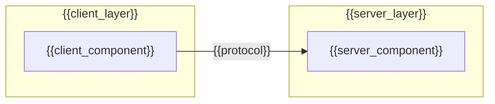
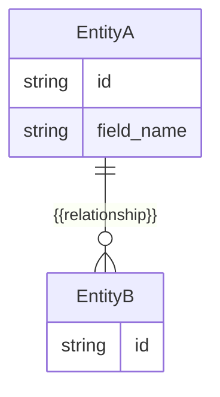
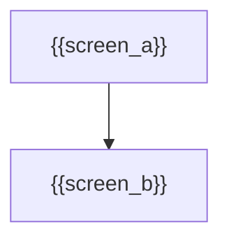

# High-Level Design: {{Title}}

**Charter:** `.sdlc/project-charter.md`
**SRS:** `.sdlc/srs.md`
**Use-Case Model:** `.sdlc/use-case-model.md`

## Status

*Tracks interview progress across sessions so work can pause and resume without redoing settled topics. Check off each topic as it's resolved — safe to ignore once every box is checked. If a topic turns out to be multi-part (spans several question rounds or sessions), split it into indented sub-items and check those off individually; check the parent once all its sub-items (or the topic as a whole) are settled. Don't delete this section. Traceability isn't tracked here — it's synthesized from the topics below, not interviewed separately.*

- [ ] Architecture Overview
- [ ] Data Model
- [ ] Technology Selection
- [ ] UI/UX Overview

## Architecture Overview

*Mandatory. The system's overall shape: major components/services and how they communicate. Node IDs (`ClientApp`, `ServerApp`, ...) are fixed labels for the diagram wiring — replace the quoted text and add/remove nodes as needed; keep node IDs plain and every label double-quoted (Mermaid treats a bare `{` as a diamond-node token even inside brackets).*

## Major Modules

*Mandatory. One entry per module/service.*

- **{{module_name}}** — {{responsibility}}

## Data Model

*Mandatory. Database structure as an entity-relationship diagram. Entity names and attribute types/names must stay plain identifiers (Mermaid's ER grammar doesn't allow braces there) — only the relationship label may hold a placeholder, since it's a quoted string.*

## Technology Selection

*Mandatory. Languages, frameworks, and hosting platforms, with rationale tied to the SRS's non-functional requirements.*

- **{{category}}** ({{e.g. Language, Framework, Database, Hosting}}): {{choice}} — {{rationale}}

## UI/UX Overview

*Optional — omit if the project has no user-facing UI. Light-touch only: key screens and high-level navigation. Detailed per-screen mockups are produced later, per ticket, by `/codely.ui`.*

- **Key Screens:** {{screen_list}}

## Traceability

*Mandatory. Map architectural decisions back to the SRS's requirements and the use-case model's actors/workflows.*

| Decision | Requirement / Use Case |
|---|---|
| {{decision}} | {{fr_or_uc_reference}} |

## Decisions

*Optional — omit if empty. "You decide" calls made during the interview, with rationale.*

{{decisions}}
