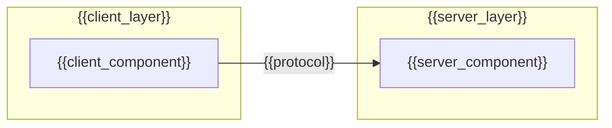
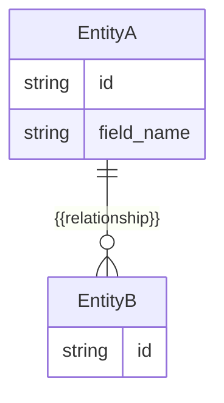
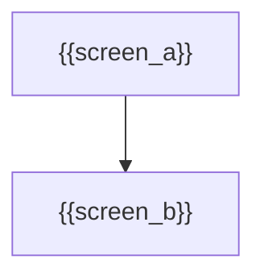

# High-Level Design: {{Title}}

**Charter:** `.sdlc/project-charter.md`
**SRS:** `.sdlc/srs.md`
**Use-Case Model:** `.sdlc/use-case-model.md`

## Status

- [ ] Architecture Overview
- [ ] Data Model
- [ ] Technology Selection
- [ ] UI/UX Overview

## Architecture Overview

## Major Modules

- **{{module_name}}** — {{responsibility}}

## Data Model

## Technology Selection

- **{{category}}** ({{e.g. Language, Framework, Database, Hosting}}): {{choice}} — {{rationale}}

## UI/UX Overview

- **Key Screens:** {{screen_list}}

## Traceability

| Decision | Requirement / Use Case |
|---|---|
| {{decision}} | {{fr_or_uc_reference}} |

## Decisions

{{decisions}}
