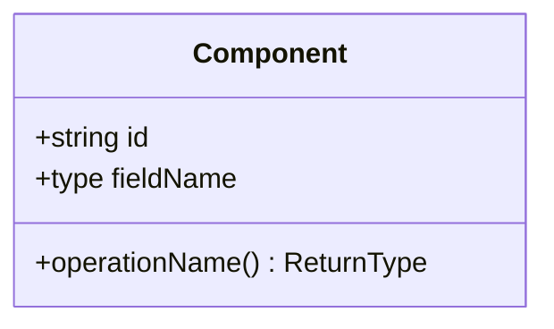

# Low-Level Design: {{Title}}

**HLD:** `.sdlc/hld.md`
**SRS:** `.sdlc/srs.md`

## Status

- [ ] Component Design
- [ ] API Endpoints
- [ ] Cross-cutting Concerns

## Component Design

### {{component_name}}

**Responsibility:** {{responsibility}}

## API Endpoints

| Method | Path | Request | Response | Auth |
|---|---|---|---|---|
| {{method}} | {{path}} | {{request_schema}} | {{response_schema}} | {{auth}} |

## Error Handling

{{error_handling}}

## Decisions

{{decisions}}
