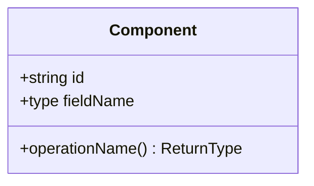

# Low-Level Design: {{Title}}

**HLD:** `.sdlc/hld.md`
**SRS:** `.sdlc/srs.md`

## Status

*Tracks interview progress across sessions so work can pause and resume without redoing settled topics. Check off each topic as it's resolved — safe to ignore once every box is checked. If a topic turns out to be multi-part (spans several question rounds or sessions), split it into indented sub-items and check those off individually; check the parent once all its sub-items (or the topic as a whole) are settled. Don't delete this section.*

- [ ] Component Design
- [ ] API Endpoints
- [ ] Cross-cutting Concerns

## Component Design

*Mandatory. One entry per module from the HLD, detailed enough for developers to implement directly. Class/attribute/method names stay plain identifiers (Mermaid's class-diagram grammar doesn't allow braces there) — rename `Component`, `id`, `fieldName`, `operationName`, `ReturnType` to the real ones.*

### {{component_name}}

**Responsibility:** {{responsibility}}

<!-- Repeat "### {{component_name}}" with its own Responsibility/diagram for each additional component. -->

## API Endpoints

*Mandatory — omit only if the system exposes no API.*

| Method | Path | Request | Response | Auth |
|---|---|---|---|---|
| {{method}} | {{path}} | {{request_schema}} | {{response_schema}} | {{auth}} |

## Error Handling

*Optional — omit if none beyond standard conventions.*

{{error_handling}}

## Decisions

*Optional — omit if empty. "You decide" calls made during the interview, with rationale.*

{{decisions}}
