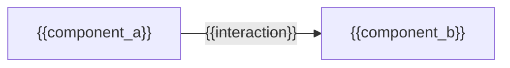
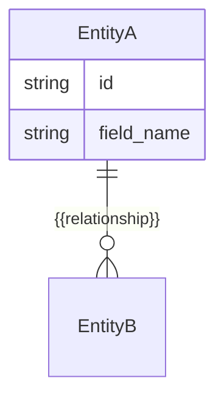
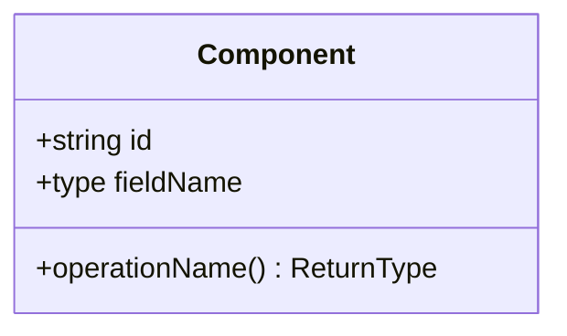

# System Design: {{Title}}

**Branch:** `{{ticketId}}/{{slug}}/feature`
**Ticket ID:** `{{ticketId}}`

## Architecture

{{architecture_notes}}

## Data Model

## API Contract

| Method | Path | Request | Response | Auth |
|---|---|---|---|---|
| {{method}} | {{path}} | {{request_schema}} | {{response_schema}} | {{auth}} |

## Component Breakdown

- **{{component_name}}** — {{responsibility}}

## Decisions

{{decisions}}
