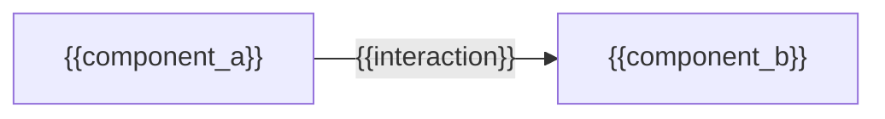
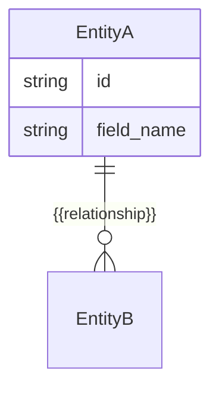
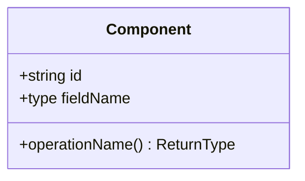

# System Design: {{Title}}

**Branch:** `{{ticketId}}/{{slug}}/feature`
**Ticket ID:** `{{ticketId}}`

## Architecture

*Mandatory. How this ticket's changes fit the existing system (or the project's `.sdlc/hld.md`, if it exists) — new or changed components and how they communicate. Keep node IDs plain and quote every label holding a placeholder (Mermaid treats a bare `{` as a diamond-node token even inside brackets).*

{{architecture_notes}}

## Data Model

*Mandatory — omit only if this ticket introduces no data changes. New or changed entities, fields, relationships. Entity names and attribute types/names must stay plain identifiers (Mermaid's ER grammar doesn't allow braces there) — only the relationship label may hold a placeholder, since it's a quoted string.*

## API Contract

*Mandatory — omit only if this ticket introduces no API changes.*

| Method | Path | Request | Response | Auth |
|---|---|---|---|---|
| {{method}} | {{path}} | {{request_schema}} | {{response_schema}} | {{auth}} |

## Component Breakdown

*Mandatory. Key modules/classes this ticket touches or introduces. Class name stays a plain identifier for the same reason as the diagrams above.*

- **{{component_name}}** — {{responsibility}}

## Decisions

*Optional — omit if empty. "You decide" calls made during the interview, with rationale.*

{{decisions}}
