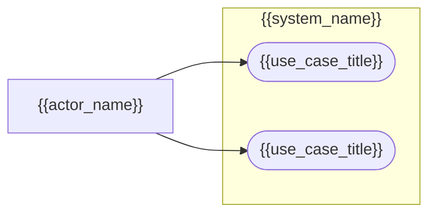
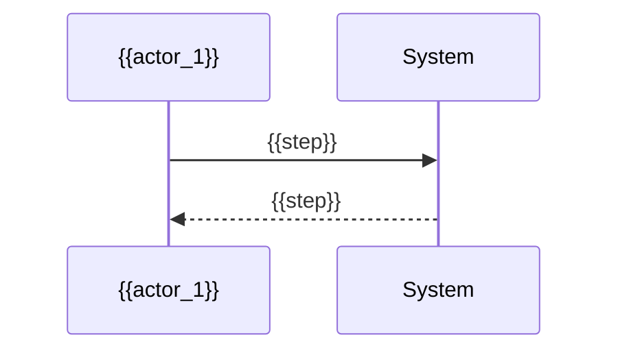

# Use-Case Model: {{Title}}

**Charter:** `.sdlc/project-charter.md`

## Status

*Tracks interview progress across sessions so work can pause and resume without redoing settled topics. Check off each topic as it's resolved — safe to ignore once every box is checked. If a topic turns out to be multi-part (spans several question rounds or sessions), split it into indented sub-items and check those off individually; check the parent once all its sub-items (or the topic as a whole) are settled. Don't delete this section.*

- [ ] Actors
- [ ] Use Cases
- [ ] User Stories
- [ ] Process Workflows

## Actors

*Mandatory. Who or what interacts with the system (end users, admins, external systems).*

- **{{actor_name}}** — {{actor_description}}

## Use Cases

*Mandatory. Key interactions between actors and the system. Mermaid has no native UML use-case shape, so actors and use cases are approximated as a flowchart: use cases as stadium nodes inside a system-boundary subgraph, actors as plain nodes connected to the use cases they perform.*

<!-- Repeat/extend the diagram, or add further diagrams per subsystem, as use cases grow. -->

### {{use_case_title}}

**Actor(s):** {{actor_name}}
**Goal:** {{goal}}
**Preconditions:** {{preconditions}}
**Main Flow:** {{main_flow}}
**Alternate/Exception Flows:** {{alternate_flows}}

<!-- Repeat "### {{use_case_title}}" with its own Actor(s)/Goal/Preconditions/Flows for each additional use case. -->

## User Stories

*Optional — omit if none captured separately from the SRS's Functional Requirements.*

- As a {{role}}, I want {{capability}}, so that {{benefit}}.

## Process Workflows

*Mandatory. Step-by-step flows for key or cross-actor processes, as Mermaid sequence diagrams.*

### {{workflow_title}}

<!-- Repeat "### {{workflow_title}}" with its own sequence diagram for each additional workflow. -->

## Notes & Decisions

*Optional — omit if empty. "You decide" calls made during the interview, with rationale.*

{{decisions}}
