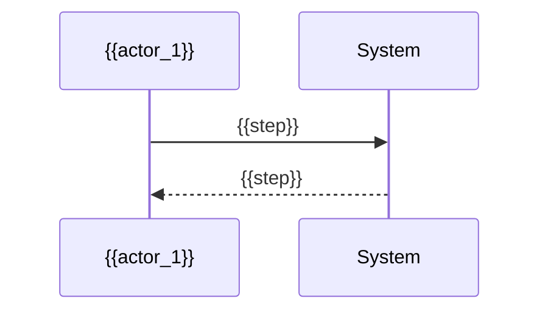

# Use-Case Model: {{Title}}

**Charter:** `.sdlc/project-charter.md`

## Status

- [ ] Actors
- [ ] Use Cases
- [ ] User Stories
- [ ] Process Workflows

## Actors

- **{{actor_name}}** — {{actor_description}}

## Use Cases

### {{use_case_title}}

**Actor(s):** {{actor_name}}
**Goal:** {{goal}}
**Preconditions:** {{preconditions}}
**Main Flow:** {{main_flow}}
**Alternate/Exception Flows:** {{alternate_flows}}

## User Stories

- As a {{role}}, I want {{capability}}, so that {{benefit}}.

## Process Workflows

### {{workflow_title}}

## Notes & Decisions

{{decisions}}
