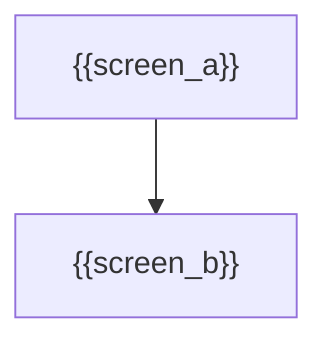

# Wireframe: {{Title}}

**HLD:** `.sdlc/hld.md`
**LLD:** `.sdlc/lld.md`

## Screens

### {{screen_title}}

**File:** `wireframes/{{screen_slug}}.html`
**Platform:** {{mobile | website | desktop}}
**States covered:** {{states}}

{{screen_description}}

## Navigation / Flow

## Layout Notes

{{layout_notes}}

## Open Questions

{{open_questions}}
