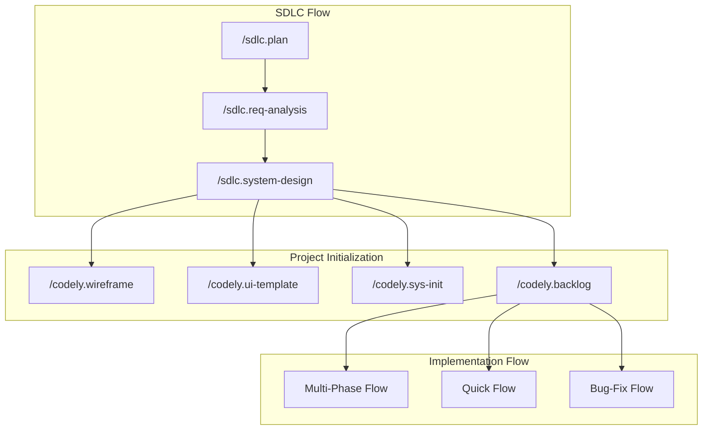

# codely.sdd

Coginitics' Spec-Driven Development (SDD) toolkit — a set of Claude Code slash commands and templates that run a project through a full software development life cycle: planning → requirements → design → real project scaffolding → ticket-by-ticket implementation → QA. Every phase is interview-driven (never guesses at material decisions) and every artifact goes through an explicit chat approval before anything touches git.

See [WORKFLOW.md](./WORKFLOW.md) for the full narrative walkthrough with diagrams — this README is the command reference and repo map.

## The Two Flows



- **SDLC Flow** (`sdlc.*`) — idea → approved project charter/plan → approved requirements (SRS + use-case model) → approved system design (HLD + LLD). Chat-only, no git actions; artifacts live under `.sdlc/`.
- **Project Initialization** — `/codely.wireframe` (optional) turns the design into a whole-product screen inventory and low-fi wireframes; `/codely.ui-template` (optional) turns that into a high-fidelity HTML/CSS design system; `/codely.sys-init` turns the approved design into a real, phased project scaffold; `/codely.backlog` turns it into a proposed ticket list. All four are independent — run any subset, in any order, though `/codely.ui-template` reads `/codely.wireframe`'s output if it ran first.
- **Implementation Flow** (`codely.*`) — per ticket, under `.specs/TICKET-ID_slug/`, real branches/commits/PRs. Three entry points depending on the change: the full **Multi-Phase Flow** (`/codely.spec`), the **Quick Flow** (`/codely.quick`) for small well-understood changes, and the **Bug-Fix Flow** (`/codely.bug-fix`) for reported bugs.

## Quick Start

```
/sdlc.plan A CRM for boutique real-estate agencies
/clear
/sdlc.req-analysis
/clear
/sdlc.system-design
/clear
/codely.wireframe       # optional — whole-product screen inventory + low-fi wireframes
/clear
/codely.ui-template     # optional — turns the wireframe into a high-fidelity HTML/CSS design system
/clear
/codely.sys-init        # once — scaffold the real project, one reviewed phase at a time
/clear
/codely.backlog
/clear
/codely.spec PROJ-1 Add agent onboarding flow
/clear
/codely.plan PROJ-1
/clear
/codely.implement PROJ-1 1
/clear
/codely.qa PROJ-1
```

Each command's final step tells you exactly what to run next (and when to `/clear` first) — this is just what that chain looks like end to end. Small, well-understood work can skip straight to `/codely.quick`; reported bugs go through `/codely.bug-fix` instead.

## Commands

Every command reads `CLAUDE.md` first (if present) and lets it override any default described here — trunk branch name, build/lint/test commands, etc. `[args]` reflects each command's `argument-hint`; omit them and the command asks instead of guessing.

### SDLC Phase Commands

Project-wide, chat-only — no branch, commit, or push. Approval happens entirely in conversation.

#### `/sdlc.plan [brief project pitch]`
Turn a one- or two-line pitch into an approved **project charter** (Goals, Scope, Feasibility Assessment, Risks & Mitigations) and **project plan** (Roadmap, Resource Allocation).
- **Writes:** `.sdlc/project-charter.md`, `.sdlc/project-plan.md`
- **Next:** `/sdlc.req-analysis`

#### `/sdlc.req-analysis [optional focus area or notes]`
Turn the approved charter into an approved **use-case model** (Actors, Use Cases, User Stories, Process Workflows — with Mermaid diagrams) and **SRS** (Functional/Non-Functional Requirements, Validation).
- **Reads:** `project-charter.md`, `project-plan.md` (if present)
- **Writes:** `.sdlc/use-case-model.md`, `.sdlc/srs.md`
- **Next:** `/sdlc.system-design`

#### `/sdlc.system-design [optional focus area or notes]`
Turn the approved requirements into an approved **HLD** (Architecture Overview, Data Model, Technology Selection, UI/UX Overview) and **LLD** (Component Design, API Endpoints, Cross-cutting Concerns). The last SDLC-phase command — its output is what the rest of the toolkit builds on.
- **Reads:** `srs.md`, `use-case-model.md`, `project-charter.md` (if present)
- **Writes:** `.sdlc/hld.md`, `.sdlc/lld.md`
- **Next:** `/codely.sys-init` and/or `/codely.backlog`

### Project Initialization

Project-wide — the bridge between an approved design and real ticket work. `/codely.wireframe` and `/codely.ui-template` are chat-only like the `sdlc.*` trio; `/codely.sys-init` is git-backed; `/codely.backlog` is chat-only too. All four are optional/independent except noted below.

#### `/codely.wireframe [optional focus area or notes]`
*Optional.* Turn the approved system design into a low-fidelity, whole-product screen inventory and wireframes (structure/navigation only, no visual styling), published live via Artifacts for review. Establishes the information architecture that `/codely.backlog` and later per-ticket `/codely.ui` runs should stay consistent with.
- **Reads:** `hld.md`, `lld.md`, `srs.md`, `use-case-model.md`, `project-charter.md` (if present)
- **Writes:** `.sdlc/wireframe.md`, `.sdlc/wireframes/*.html`
- **Next:** `/codely.ui-template` (optional) or straight to `/codely.sys-init`/`/codely.backlog`

#### `/codely.ui-template [optional focus area or notes]`
*Optional.* Turn the approved system design — and `/codely.wireframe`'s output, if present — into a high-fidelity, whole-product HTML/CSS design system: real tokens (palette/typography/spacing) applied across the key screens, published live via Artifacts for review. Proactively proposes a theme direction from the project's idea, industry, and target audience rather than waiting to be asked. This is what `/codely.ui`'s design-system discovery checks first, so every ticket's mockups share one look instead of each falling back to a placeholder style.
- **Reads:** `hld.md`, `lld.md`, `wireframe.md` (if present), `project-charter.md`, `srs.md` (if present)
- **Writes:** `.sdlc/ui-template.md`, `.sdlc/ui-template/tokens.css`, `.sdlc/ui-template/*.html`
- **Next:** `/codely.sys-init` and/or `/codely.backlog`

#### `/codely.sys-init [phase-number]`
Turn the approved design into a real, running project structure, one reviewed phase at a time. First run interviews you and writes `.sdlc/construction-plan.md` — a phased breakdown where every phase lists the exact scaffolding/install commands it will run, reviewed before anything executes. Every later run (after `/clear`, once the previous phase's PR is merged) executes the next unchecked phase: branch, scaffold, verify, approve, commit, push, PR. The only command in this toolkit allowed to write and install real project files outside `.sdlc/`/`.specs/`.
- **Reads:** `.sdlc/hld.md`, `.sdlc/lld.md`, `.sdlc/project-plan.md` (if present)
- **Writes:** `.sdlc/construction-plan.md`, then real project files/directories, phase by phase
- **Git:** commits the plan to `sys-init/plan` (push + draft PR); each phase after that commits to its own `sys-init/phase-slug` (push + draft PR)
- **Next:** re-run `/codely.sys-init` until every phase is checked off, then `/codely.spec` per ticket

#### `/codely.backlog [optional focus area or notes]`
Turn the approved design into a proposed, board-agnostic ticket backlog — one entry per ticket, traceable to the SRS's requirements and the LLD's components/endpoints, grouped into dependency-ordered waves. Draft-only: never calls a real tracker's API. Create the actual tickets on your team's board from this list.
- **Reads:** `hld.md`, `lld.md`, `srs.md`, `use-case-model.md`, `project-plan.md` (if present)
- **Writes:** `.sdlc/backlog.md`
- **Next:** create tickets on your board, then `/codely.spec TICKET-ID description` per ticket

### Ticket Lifecycle — Multi-Phase Flow

Per ticket, under `.specs/TICKET-ID_slug/`. For anything substantial enough to warrant its own spec, design review, and a phased implementation.

#### `/codely.spec [ticket-id] [brief description]`
Turn a ticket ID + brief description into an approved spec (Summary, Context, Functional Requirements, Acceptance Criteria, and more), then cut the ticket's branch. Drafts `.claude/includes/ticket-format.md` on first use if it doesn't exist yet, and validates the ticket ID against it.
- **Writes:** `.specs/TICKET-ID_slug/spec.md`
- **Git:** creates `TICKET-ID/slug/feature`, commits `spec.md` to it (no push)
- **Next:** `/codely.sys-design` and/or `/codely.ui` (both optional), or straight to `/codely.plan`

#### `/codely.sys-design [ticket-id]`
*Optional.* Turn the approved spec into a ticket-level system design — architecture, data model, API contract, component breakdown — consistent with the project-wide HLD/LLD if they exist. Skip it for tickets that don't need explicit design beyond the spec.
- **Reads:** `spec.md`, `.sdlc/hld.md`/`.sdlc/lld.md` (if present)
- **Writes:** `.specs/TICKET-ID_slug/system-design.md`
- **Git:** commits to the existing docs branch (no push)
- **Next:** `/codely.ui` (optional) or `/codely.plan`

#### `/codely.ui [ticket-id]`
*Optional.* Turn the approved spec into previewable screen mockups (self-contained HTML/CSS, published live via Artifacts for review) plus a design breakdown. Checks `.sdlc/ui-template/` first for a project-wide design system, then the live codebase's existing conventions; flags a neutral placeholder style only if neither exists.
- **Reads:** `spec.md`, `system-design.md` (if present)
- **Writes:** `.specs/TICKET-ID_slug/design.md`, `.specs/TICKET-ID_slug/design/*.html`
- **Git:** commits to the existing docs branch (no push)
- **Next:** `/codely.plan`

#### `/codely.plan [ticket-id]`
Turn the approved spec (+ design, if any) into a phased implementation plan — each phase with its own branch slug, ordered tasks with done-criteria, and key files — plus a QA Plan checklist. Below ~10 files and low complexity, it recommends `/codely.quick` instead.
- **Reads:** `spec.md`, `system-design.md`/`design.md` (if present)
- **Writes:** `.specs/TICKET-ID_slug/plan.md` (+ `follow-up.md` if items are deferred)
- **Git:** commits to the docs branch, pushes, opens a draft PR (spec + design + plan reviewed together)
- **Next:** `/codely.implement`

#### `/codely.implement [ticket-id] [phase-number]`
Implement one phase of the approved plan, verify it (build/lint/test, and exercise the feature in a running app for UI-facing changes), then commit, push, and open it as its own PR. One run = one phase.
- **Reads:** `spec.md`, `system-design.md`/`design.md`/`follow-up.md` (if present), the target phase from `plan.md`
- **Writes:** the application code for that phase; `plan.md` (task checkboxes); `follow-up.md` (if new deferred items surface)
- **Git:** branches `TICKET-ID/phase-slug` off trunk (or the previous phase's branch), commits, pushes, opens a draft PR
- **Next:** repeat for each remaining phase, then `/codely.qa`

#### `/codely.qa [ticket-id]`
Verify every task across the plan is complete, then walk the plan's QA Plan checklist against the implementation — running what's machine-verifiable itself, walking the rest with you. Verifies only; on any failure it stops and reports rather than fixing anything.
- **Reads:** `spec.md`, `system-design.md`/`design.md`/`follow-up.md` (if present), the full plan document
- **Writes:** QA results into the plan document
- **Git:** commits the plan document, pushes, ticks `QA Done` on the PR, marks it ready for review — only once nothing has Failed
- **Next:** `/codely.follow-up` if `follow-up.md` has open items, otherwise get the PR merged

#### `/codely.follow-up [ticket-id]`
Triage `follow-up.md` one item at a time: **Promote** (create a real ticket, via a connected task tracker if available), **Integrate** (fold a small change into this PR now), **Drop** (with a reason), or **Other** (your call).
- **Reads:** `spec.md`, the plan document
- **Writes:** `follow-up.md`; application code for any Integrate items
- **Git:** commits, pushes, ticks `Follow-Up Triaged` once every item is resolved
- **Next:** get the PR reviewed and merged

### Alternate Entry Points

Bypass the multi-phase flow for cases that don't need it.

#### `/codely.quick [ticket-id] [brief description]`
For small, well-understood changes: one interview covers what a spec interview and a plan interview would each cover, folded into a single `quick-plan.md`, implemented and opened as one PR in one run. Steps back to the full flow if the change turns out to be bigger than expected.
- **Writes:** `.specs/TICKET-ID_slug/quick-plan.md`, the application code, `follow-up.md` (if items are deferred)
- **Git:** branches `TICKET-ID/slug/quick`; commits the plan, then the implementation; pushes; opens a draft PR
- **Next:** `/codely.qa` (optional) and/or `/codely.follow-up` (if applicable), then merge

#### `/codely.bug-fix [ticket-id] [brief description]`
Reproduce a reported bug, confirm its root cause **with you before writing any fix code**, then implement the fix behind a regression test proven failing (red) before the fix and passing (green) after — each its own commit, so the proof is durable and independently checkable.
- **Writes:** `.specs/TICKET-ID_slug/bug-fix-plan.md`, a regression test, the fix code, `follow-up.md` (if items are deferred)
- **Git:** branches `TICKET-ID/slug/bug-fix`; commits the plan, then the failing test alone, then the fix; pushes; opens a draft PR
- **Next:** `/codely.qa` (optional) and/or `/codely.follow-up` (if applicable), then merge

## Trainer Flow

Independent of the SDLC/Implementation flows above — turns a course brief into a self-paced, git-tracked curriculum under `.courses/<course-slug>/`.

#### `/trainer.start [brief course description]`
Interview you into an approved curriculum — modules lettered A, B, C…, each with lessons numbered 1, 2, 3… (id `A.1`, etc.) and a final `(Workshop)` lesson — then cut the course's branch with it committed and pushed.
- **Writes:** `.courses/<slug>/curriculum.md`
- **Git:** creates `course/<slug>`, commits `curriculum.md`, pushes
- **Next:** `/trainer.train <slug>`

#### `/trainer.train [course-slug] [lesson-id]`
Deliver one lesson — a self-contained `lesson.html` (explanation, examples, code samples, a visualization, exercises), previewed live via Artifacts. Waits for you to confirm you've taken it, then lets you choose a quiz (graded from your filled-in `quiz.md`) or a small project (`project.md`, recorded once you confirm you're done) before ticking the lesson — and, once every lesson under it is ticked, its module — in the curriculum. No lesson id → picks the first unticked lesson.
- **Reads:** `.courses/<slug>/curriculum.md`
- **Writes:** `.courses/<slug>/<lesson-id>_<lesson-slug>/lesson.html` (+ `quiz.md` or `project.md` if chosen); `curriculum.md` (checkboxes, quiz score / project summary)
- **Git:** commits to the existing `course/<slug>` branch, pushes (no PR)
- **Next:** re-run `/trainer.train <slug>` for the next unticked lesson, until the course is complete

## Repository Structure

```
.claude/commands/
├── codely.quick.md         ← /codely.quick — fast path for small, well-understood changes
├── codely.wireframe.md     ← /codely.wireframe — optional: approved system design to a whole-product low-fi wireframe
├── codely.ui-template.md   ← /codely.ui-template — optional: approved system design (+ wireframe) to a high-fidelity HTML/CSS design system
├── codely.sys-init.md      ← /codely.sys-init — approved system design to a real, phased project scaffold
├── codely.backlog.md       ← /codely.backlog — approved system design to a proposed, board-agnostic ticket backlog
├── codely.spec.md          ← /codely.spec — turns a requirement into a spec
├── codely.sys-design.md    ← /codely.sys-design — optional: approved spec to ticket-level system design (architecture/data/API/components)
├── codely.plan.md          ← /codely.plan — turns a spec into an implementation plan
├── codely.implement.md     ← /codely.implement — executes an implementation plan
├── codely.qa.md            ← /codely.qa — verifies an implementation against its spec/plan
├── codely.follow-up.md     ← /codely.follow-up — captures post-delivery feedback and next steps
├── codely.bug-fix.md       ← /codely.bug-fix — reproduce, root-cause, and fix a reported bug behind a red→green regression test
├── codely.ui.md            ← /codely.ui — approved spec to previewable screen mockups + design breakdown
├── sdlc.plan.md            ← /sdlc.plan — SDLC planning phase: idea → approved project charter + project plan
├── sdlc.req-analysis.md    ← /sdlc.req-analysis — SDLC requirements analysis phase: charter → approved SRS + use-case model
├── sdlc.system-design.md   ← /sdlc.system-design — SDLC system design phase: SRS/use-case model → approved HLD + LLD
├── trainer.start.md        ← /trainer.start — course brief to an approved, branched curriculum
└── trainer.train.md        ← /trainer.train — delivers one lesson (content, quiz/project, progress)

.claude/templates/
├── wireframe.md          ← whole-product screen inventory/navigation template, paired with wireframes/*.html, used by /codely.wireframe
├── ui-template.md        ← whole-product design tokens/screens template, paired with ui-template/*.html, used by /codely.ui-template
├── spec.md              ← requirements spec template
├── system-design.md     ← ticket-level system design template (architecture/data model/API contract/components), used by /codely.sys-design
├── design.md             ← screen inventory / component breakdown template, paired with design/*.html mockups
├── plan.md               ← implementation plan template
├── quick-plan.md         ← combined spec+plan template for /codely.quick
├── bug-fix-plan.md       ← combined investigation+fix template for /codely.bug-fix
├── follow-up.md          ← post-delivery follow-up template
├── project-charter.md    ← SDLC project charter template (goals/scope/feasibility/risk), used by /sdlc.plan
├── project-plan.md       ← SDLC project plan template (roadmap/milestones/resourcing), used by /sdlc.plan
├── use-case-model.md     ← SDLC use-case model template (actors/use cases/user stories/workflows), used by /sdlc.req-analysis
├── srs.md                ← SDLC Software Requirements Specification template, used by /sdlc.req-analysis
├── hld.md                ← SDLC High-Level Design template (architecture/data model/tech stack), used by /sdlc.system-design
├── lld.md                ← SDLC Low-Level Design template (component/class design/API contracts), used by /sdlc.system-design
├── construction-plan.md  ← phased project-scaffolding plan template (branches/tasks/commands), used by /codely.sys-init
├── backlog.md            ← proposed ticket backlog template (waves/dependencies/sizing), used by /codely.backlog
└── curriculum.md         ← course curriculum template (lettered modules/numbered lessons), used by /trainer.start

.claude/includes/
└── ticket-format.md     ← per-project ticket ID pattern/regex — drafted on first use by /codely.spec, /codely.quick, or /codely.bug-fix
```

## Conventions

The essentials — see [WORKFLOW.md](./WORKFLOW.md)'s Cross-Cutting Conventions section for the full detail:

- **`.sdlc/`** holds project-wide artifacts (SDLC phases + `codely.wireframe`/`codely.ui-template`/`codely.sys-init`/`codely.backlog`'s output). **`.specs/TICKET-ID_slug/`** holds one ticket's artifacts. **`.courses/course-slug/`** holds one course's curriculum + lessons (`trainer.*`), entirely separate from the SDLC/Implementation flows. Never mixed.
- **No git changes before approval**, everywhere — every artifact-producing phase ends in a chat-only review before any branch/commit/push.
- **Resumable by design** — `/clear` mid-flow and re-run the same command; interview artifacts resume via a `## Status` topic checklist, phased/task artifacts resume via `- [ ]` task checkboxes.
- **`QA Done`** and **`Follow-Up Triaged`** are PR checkboxes ticked only by `/codely.qa` and `/codely.follow-up` respectively, gating that PR's merge where they apply.
- **`gh` CLI is optional** — every push/PR step falls back to manual instructions if it's unavailable.

## Status

All commands and templates listed above are implemented. See [WORKFLOW.md](./WORKFLOW.md) for the full narrative walkthrough with diagrams for each flow.
