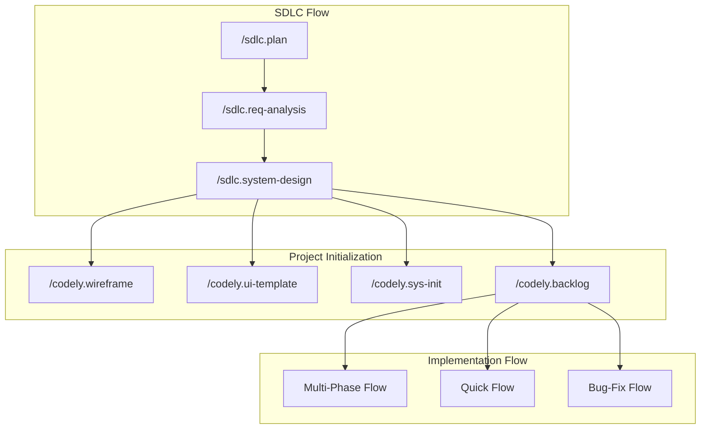
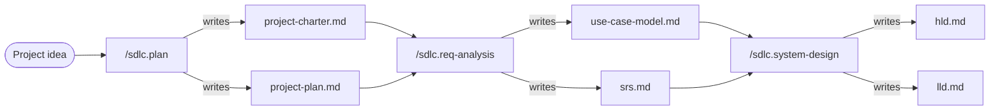
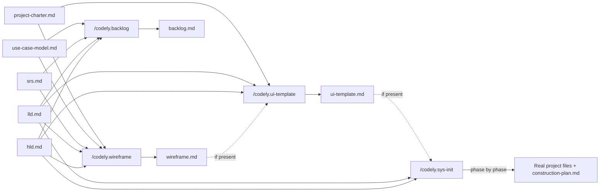
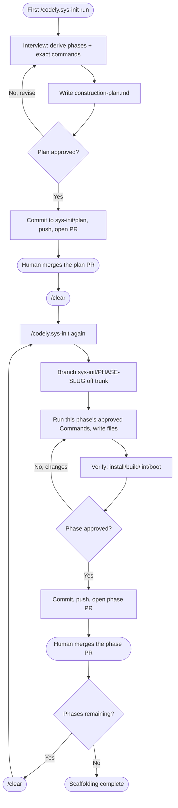
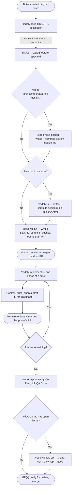
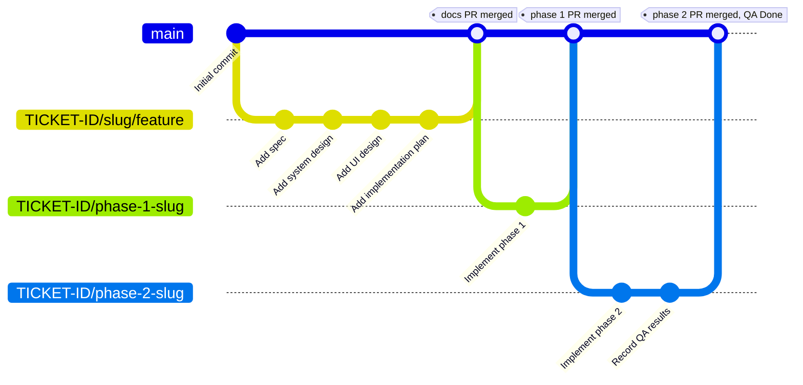
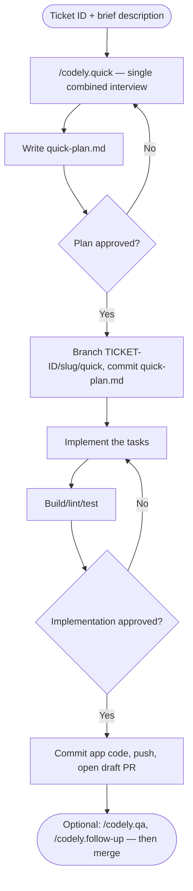
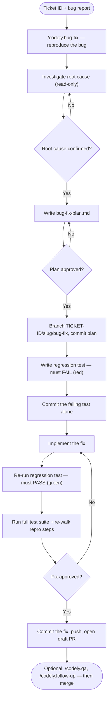

# SDD Workflow

`codely.sdd` runs a project through two flows, back to back:

1. **The SDLC Flow** (`sdlc.*`) — project-wide, chat-only, no git actions. Turns an idea into an approved project charter, requirements spec, and system design.
2. **The Implementation Flow** (`codely.*`) — per ticket, git-backed. Turns an approved design into reviewed, merged, working code.

Everything below expands each box. Every command in this toolkit also respects a project's `CLAUDE.md` wherever it conflicts with the defaults described here (trunk branch name, build/test commands, etc.).

---

## 1. Background: The Software Development Life Cycle

The Software Development Life Cycle (SDLC) is the standard sequence of phases a piece of software moves through, from idea to retirement. `codely.sdd` models this sequence directly — most phases below map onto a specific command or flow in this toolkit.

| Phase | Core Activities | Typical Output |
|---|---|---|
| **Planning / Initiation** | Define the problem/opportunity, business case, feasibility (technical/financial/operational), high-level scope, resourcing, risk identification | Project charter, feasibility assessment, high-level roadmap |
| **Requirements Analysis** | Elicit requirements from stakeholders, identify actors/use cases/user stories, define functional & non-functional requirements, prioritize, validate against goals | Software Requirements Specification (SRS), use-case model, requirements traceability |
| **Design** | Define architecture (components, communication, data flow), select the tech stack, model data, design APIs/interfaces, decompose into component/class-level detail, UI/UX for user-facing systems | High-Level Design (architecture, data model, tech stack), Low-Level Design (component design, API contracts) |
| **Implementation / Development** | Write code against the design, unit test, code review, integrate modules, manage via version control | Working source code, unit test results, build artifacts |
| **Testing / QA** | Integration/system/regression testing, UAT, defect tracking and fixing, performance/security testing | Test plans/cases, test reports, a verified build ready to release |
| **Deployment / Release** | Release planning, environment provisioning, staged rollout, data migration, rollback planning | The live system, release notes, deployment docs |
| **Maintenance / Operations** | Monitor production, patch and fix bugs, tune performance, handle minor enhancements and support, feed learnings into the next planning cycle | Patches/updates, incident reports, a backlog for the next iteration |

Waterfall runs these once, in strict sequence; Agile/iterative models loop through the same phases in short cycles per feature — the phase content doesn't change, only the cadence and how much of each phase happens per iteration.

**Where `codely.sdd` fits today:**

| SDLC Phase | Covered by |
|---|---|
| Planning | `/sdlc.plan` |
| Requirements Analysis | `/sdlc.req-analysis` |
| Design | `/sdlc.system-design`, `/codely.wireframe`, `/codely.ui-template` (project-wide) and `/codely.sys-design` / `/codely.ui` (per ticket) |
| Implementation | `/codely.sys-init` (project scaffold) and `/codely.spec` → `/codely.plan` → `/codely.implement` (per ticket) |
| Testing / QA | `/codely.qa` |
| Deployment | *not yet covered* |
| Maintenance | `/codely.follow-up` covers post-delivery triage; ongoing production monitoring/operations aren't covered |

---

## 2. The SDLC Flow

Three commands, run once per project, each turning the previous phase's approved artifact(s) into the next:

| Command | Reads | Writes (`.sdlc/`) | What it covers |
|---|---|---|---|
| `/sdlc.plan` | — (a one-line pitch) | `project-charter.md`, `project-plan.md` | Goals, Scope, Feasibility Assessment, Risks & Mitigations · Roadmap, Resource Allocation |
| `/sdlc.req-analysis` | `project-charter.md`, `project-plan.md` | `use-case-model.md`, `srs.md` | Actors, Use Cases, User Stories, Process Workflows · Functional/Non-Functional Requirements, Validation |
| `/sdlc.system-design` | `srs.md`, `use-case-model.md` | `hld.md`, `lld.md` | Architecture Overview, Data Model, Technology Selection, UI/UX Overview · Component Design, API Endpoints, Cross-cutting Concerns |

**How each one runs:** an interview, one topic at a time, in the order listed above. Every topic's answer is written to its artifact's file the moment it's resolved — not batched at the end — so the interview can be interrupted (`/clear` mid-session, or just stopping) and resumed later without re-answering anything already settled. Each artifact's `## Status` checklist (right under its title) tracks this: running the command again reads it and either offers to resume at the first open topic, or — once everything's checked — to revise or start over. Diagrams (architecture, ER, use-case, sequence) are drawn in Mermaid directly inside the artifact.

No git action ever happens in this flow. Approval is a chat-only gate: you review the artifact(s) in conversation, and the command doesn't move on until you say so.

---

## 3. Project Initialization

Once `hld.md`/`lld.md` are approved, four independent commands bridge the SDLC flow into real work — run any subset, in any order, depending on what the project needs:

- **`/codely.wireframe`** (optional) turns the HLD's UI/UX Overview plus the SRS's requirements and the use-case model's workflows into a low-fidelity, whole-product screen inventory and wireframes at `.sdlc/wireframe.md` — structure and navigation only, no visual styling. Proactively proposes a layout/IA direction from the charter's stated audience and industry rather than waiting to be asked. Establishes the information architecture that everything downstream (backlog, per-ticket `/codely.ui`) should stay consistent with.
- **`/codely.ui-template`** (optional) turns that wireframe — or the HLD directly, if no wireframe was run — into a high-fidelity HTML/CSS design system at `.sdlc/ui-template.md`: real color/typography/spacing tokens applied across the key screens. Proactively proposes 2-3 candidate visual directions grounded in the project's idea, industry, and target audience, gets one confirmed, then drafts. This becomes the design system `/codely.ui` checks for first on every later ticket, so mockups share one look instead of each falling back to a placeholder style.
- **`/codely.backlog`** cross-references the SRS's requirements against the LLD's components/endpoints and proposes a dependency-ordered, wave-grouped ticket list at `.sdlc/backlog.md`. It's a proposal only — it never calls a real tracker's API. You create the actual tickets on your team's board (Jira/Linear/GitHub Issues/whatever) from this list.
- **`/codely.sys-init`** turns the design into an actual, running project skeleton — if `.sdlc/ui-template/tokens.css` exists, a UI-facing phase can seed real theme config from it. It's the one command in this toolkit allowed to write and install real project files outside `.sdlc/`/`.specs/` — see below, since its shape is different enough from everything else to warrant its own diagram.

`/codely.wireframe` and `/codely.ui-template` are chat-only, like the `sdlc.*` trio — no branch, commit, or push. Approval happens entirely in conversation, same as the SDLC Flow above.

### `/codely.sys-init`: a reentrant, phased scaffold

Scaffolding a whole stack — repo tooling, one or more services, a database layer, CI, deployment — isn't a single reviewable action, so this command works like `/codely.plan` + `/codely.implement` fused into one: the first run plans, every later run executes one more phase.

The safety mechanism worth calling out: `construction-plan.md` lists every scaffolding-CLI/installer command each phase will run, **before** any of them execute. Execution mode only ever runs a command already listed there — if a phase turns out to need one that isn't, the command stops and asks whether to amend the plan rather than improvising. Full "run real installers and scaffolding tools" power, but nothing runs unreviewed. It's also the one command with an explicit non-destructive conflict policy: if a target file or directory already exists and isn't empty, it's left alone and noted as already-present rather than overwritten — so a partially hand-built or partially-scaffolded repo can be resumed safely.

Once every phase is checked off, the project is ready for real ticket work — `/codely.spec` per ticket, per the flows below.

---

## 4. The Implementation Flow (`codely.*`)

Everything from here on works **per ticket**, under `.specs/TICKET-ID_slug/`, and drives real git branches, commits, and PRs. There are three ways into it, chosen by how well-understood the change is:

| | Multi-Phase Flow | Quick Flow | Bug-Fix Flow |
|---|---|---|---|
| Entry command | `/codely.spec` | `/codely.quick` | `/codely.bug-fix` |
| Best for | Larger or ambiguous features; anything worth a separate architecture/UI review | Small, well-understood changes (roughly under ~10 files) | Reported bugs — built around proving root cause before and after |
| Review cycles | Spec review → (design review) → (UI review) → plan review → one review per implementation phase | One plan review, one implementation review | One plan review, one implementation review |
| Branches | `TICKET-ID/slug/feature` (docs) + one `TICKET-ID/phase-slug` per phase | One `TICKET-ID/slug/quick` | One `TICKET-ID/slug/bug-fix` |
| PRs | One docs PR + one PR per phase | One PR | One PR |
| Root-cause gate | — | — | Mandatory: root cause must be confirmed by you before any fix code is written |
| Regression test | Optional (via the plan's QA Plan) | Optional (via the plan's QA Plan) | Mandatory: written failing (red) and committed *before* the fix, re-run passing (green) *after* |

All three converge on the same finishing move: `/codely.qa` verifies and ticks a `QA Done` PR checkbox (never fixes — it stops and reports on failure), and `/codely.follow-up` triages anything deferred along the way and ticks a `Follow-Up Triaged` checkbox. Both checkboxes, where they apply, gate the PR's merge.

### 4.1 Multi-Phase Flow

For anything substantial enough to warrant a written spec, its own architecture/UI review, and an implementation broken into reviewable phases.

`/codely.sys-design` and `/codely.ui` are both optional and independent of each other — skip either or both for tickets that don't need them; every downstream command already treats their files as "present → read it," so nothing breaks if they're absent. `/codely.ui` checks `.sdlc/ui-template/` first for a project-wide design system (see §3), then the live codebase, before falling back to a neutral placeholder style.

**Branch topology.** Every doc for a ticket (spec, optional design, optional UI, plan) accumulates on one shared branch, committed as each is approved; only implementation gets its own branch per phase, based on trunk once the previous phase has merged (or stacked on the previous phase's branch if it hasn't yet):

### 4.2 Quick Flow

For small, well-understood changes — one interview covers what a spec interview and a plan interview would each cover, one combined `quick-plan.md`, one branch, one PR.

If Phase 4's sizing check finds the change is actually larger than "quick," or Phase 2 finds a `spec.md`/`plan.md` already exists for that ticket, the command tells you and offers to switch to the Multi-Phase Flow instead of forcing a bad fit.

### 4.3 Bug-Fix Flow

Built around proof: a regression test that's shown failing before the fix and passing after, each its own commit — and a root-cause confirmation gate before any fix code is written, so you're not paying for a wrong hypothesis after the fact.

The PR that lands references both commits by identity: the regression test's commit SHA (proof it failed without the fix) and the fix commit's exact message (proof it passes with the fix) — durable, independently-checkable evidence, not just a claim in the PR description.

---

## 5. Cross-Cutting Conventions

These hold across every command in the family:

- **Approval is a chat-only gate.** Every phase that writes an artifact or changes code ends with "review it, approve or request changes" before anything git-related happens. The rule is "no git changes before approval" everywhere — the only narrow exception is `.claude/includes/ticket-format.md`, which the first ticket-touching command (`/codely.spec`, `/codely.quick`, or `/codely.bug-fix`) drafts and commits immediately on first use, since it's shared project config rather than part of that ticket's own artifact.
- **`.sdlc/` is project-wide; `.specs/TICKET-ID_slug/` is per-ticket.** Nothing in `.sdlc/` is ever branched or committed by the `sdlc.*` commands themselves (chat-only, by design). `codely.sys-init` is the one exception that does commit `.sdlc/` content (`construction-plan.md`), since its output is meant to become real, git-tracked project state; `codely.backlog` stays chat-only like the `sdlc.*` commands — its backlog is a proposal for you to act on, not itself part of the tracked history.
- **Resumability is built in, two ways.** Multi-topic interview artifacts (`sdlc.*`'s charter/plan/SRS/use-case-model/HLD/LLD) track a `## Status` checklist of interview topics, checked off as each is resolved. Phased execution artifacts (`plan.md`, `quick-plan.md`, `bug-fix-plan.md`, `construction-plan.md`) track progress as `- [ ]` task checkboxes within each phase instead. Either way, `/clear`-ing and re-running the same command picks up exactly where you left off rather than re-asking settled questions.
- **PR gating checkboxes.** `- [ ] QA Done` (ticked only by `/codely.qa`, only once nothing's Failed) and `- [ ] Follow-Up Triaged` (ticked only by `/codely.follow-up`, only once every item is resolved) appear in a PR body when applicable and are meant to gate that PR's merge.
- **`gh` CLI is optional.** Every push/PR step checks for it first; if it's unavailable, the command tells you exactly what to push and what PR to open manually instead of failing.
- **`CLAUDE.md` wins.** Trunk branch name, build/lint/test commands, and any other project-specific convention: if `CLAUDE.md` exists and says otherwise, it overrides what's described here.

See [README.md](./README.md) for the full command reference (usage, inputs, outputs) and repo structure.
